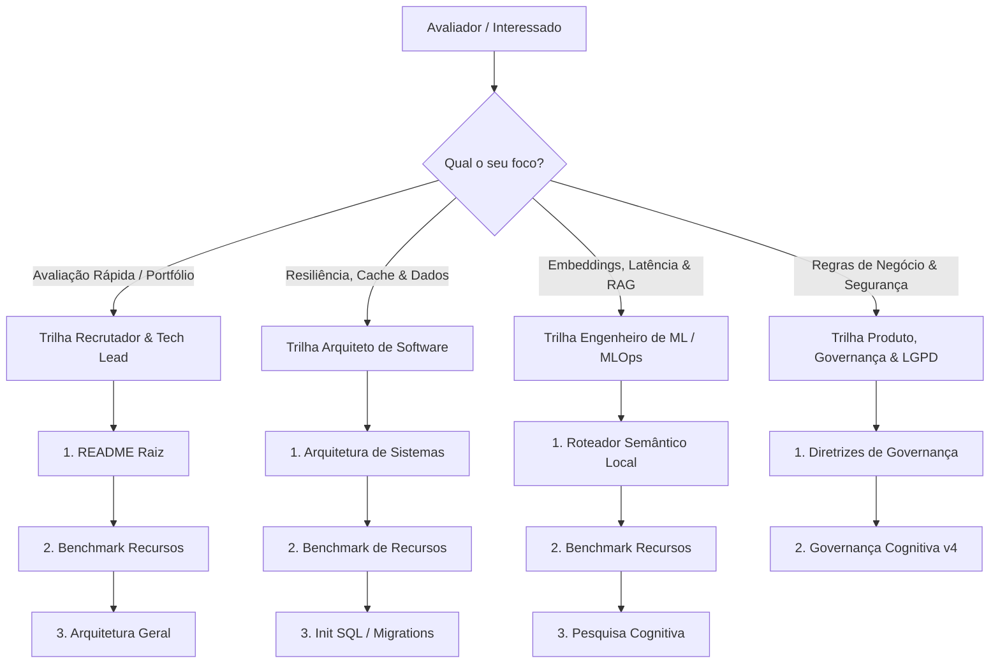
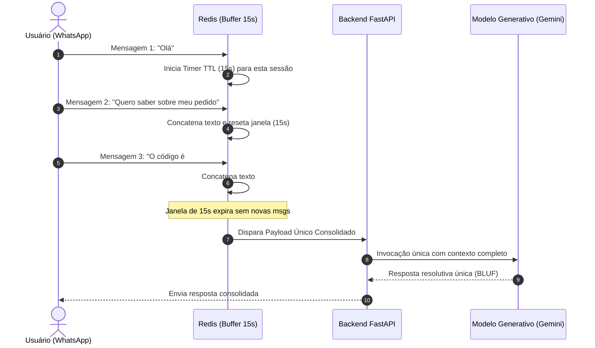

# 📚 Hub de Documentação Técnica & Engenharia de IA — Z-Oracle Atendee

Bem-vindo à documentação técnica oficial do **Z-Oracle Atendee**. Este diretório reúne whitepapers, especificações de arquitetura, benchmarks empíricos e diretrizes de governança conversacional que fundamentam o projeto.

Este material foi estruturado para fornecer visibilidade profunda a **Engenheiros de IA, Arquitetos de Software, Tech Leads e Avaliadores Técnicos** interessados em avaliar rigor de código, design de sistemas resilientes e mitigação prática de alucinações em LLMs.

---

## 🧭 Trilhas de Leitura Guiada por Perfil

Selecione a trilha mais alinhada ao seu objetivo de avaliação:

### 1. 🎯 Trilha: Recrutador Técnico & Tech Lead (Visão 10 minutos)
1. **[`README.md`](../README.md):** Visão geral da stack, propósito de negócio e comando único de inicialização.
2. **[`benchmark-recursos.md`](./benchmark-recursos.md):** Consumo real de RAM/CPU em 3 cenários operacionais e custos de hospedagem (< US$ 5/mês).
3. **[`arquitetura.md`](./arquitetura.md):** Como o sistema foi projetado para evitar custos desnecessários de nuvem.

### 2. 🏛️ Trilha: Arquiteto de Software & Infraestrutura
1. **[`arquitetura.md`](./arquitetura.md):** Debounce distribuído de 15s no Redis, persistência transacional e isolamento de estado.
2. **[`benchmark-recursos.md`](./benchmark-recursos.md):** Modelagem matemática de saturação de CPU/RAM sob rajadas de 100 req/s.
3. **[`docker/postgres/init.sql`](../docker/postgres/init.sql):** Esquema relacional, índices HNSW vetoriais e tabela `schema_migrations`.

### 3. 🧠 Trilha: Engenheiro de Machine Learning & MLOps
1. **[`roteadorsemantico.md`](./roteadorsemantico.md):** Prova de inferência local SIMD com `all-MiniLM-L6-v2` em 6.35 ms sem chamadas a APIs pagas.
2. **[`benchmark-recursos.md`](./benchmark-recursos.md):** Comportamento do runtime PyTorch C++ CPU e matrizes NumPy sob concorrência.
3. **[`pesquisa.md`](./pesquisa.md):** Teoria de Primeiros Princípios, matriz Cynefin e transição de inferência probabilística para determinística.

### 4. 🛡️ Trilha: Product Manager, Compliance & LGPD
1. **[`diretrizes.md`](./diretrizes.md):** Protocolo 2-step question, anti-drift conversational e mascaramento de PII.
2. **[`governanca-cognitiva.md`](./governanca-cognitiva.md):** Classificação de domínio Cynefin, veredicto oculto de telemetria e saída estruturada no padrão Minto (BLUF).

---

## 🗺️ Índice Geral de Documentos

| Documento | Foco Técnico | Dimensão Avaliada |
| :--- | :--- | :--- |
| **[`benchmark-recursos.md`](./benchmark-recursos.md)** | **Consumo de Hardware & Sizing** | RAM e CPU em 3 cenários (Standby 367MB, Carga 522MB, Pico 958MB) e guias de nuvem. |
| **[`arquitetura.md`](./arquitetura.md)** | **Engenharia de Sistemas** | Debounce no Redis (15s), persistência stateful, WAF semântico e pool asyncpg. |
| **[`roteadorsemantico.md`](./roteadorsemantico.md)** | **Inferência On-Premise** | Triagem vetorial local em CPU (`all-MiniLM-L6-v2`) com latência de **6.35 ms**. |
| **[`governanca-cognitiva.md`](./governanca-cognitiva.md)** | **Especificação Cognitiva v4** | Domínios Cynefin, anti-drift, veredicto de telemetria e arquitetura BLUF (Minto Pyramid). |
| **[`diretrizes.md`](./diretrizes.md)** | **Governança Conversacional** | Regras de ouro de atendimento, protocolo 2-step gate e conformidade com LGPD. |
| **[`pesquisa.md`](./pesquisa.md)** | **Epistemologia & Oráculo IA** | Tese de transição de IA probabilística para raciocínio analítico (TRIZ, Cynefin, GraphRAG). |

---

## ⚡ Fluxos Críticos de Arquitetura

### A. Coalescência de Mensagens Humanas (Debounce de 15s no Redis)

---

## ⚖️ Comparativo: Abordagem Convencional vs Z-Oracle Atendee

| Dimensão Técnica | Chatbot Tradicional / "Wrapper Ingênuo" | Z-Oracle Atendee (Este Projeto) |
| :--- | :--- | :--- |
| **Triagem de Mensagens** | Cada "olá" ou mensagem parcial invoca a API externa paga da OpenAI/Claude. | **Roteamento local em CPU (6.3ms)** com modelo `all-MiniLM-L6-v2` sem custo de token. |
| **Rajadas de Digitação** | Dispara 3 a 5 chamadas simultâneas de IA gerando respostas concorrentes desordenadas. | **Buffer Redis de 15s** que coalese rajadas humanas em um único turno de diálogo. |
| **Busca Semântica (RAG)** | Dependência de serviços SaaS caros de terceiros (Pinecone, Qdrant Cloud). | **PostgreSQL nativo com extensão pgvector** e índices HNSW hospedados no mesmo cluster. |
| **Segurança & LGPD** | Envia CPFs, cartões e dados sensíveis direto para APIs externas de LLM. | **Sanitização determinística regex em memória** antes de qualquer transmissão externa. |
| **Estrutura de Resposta** | Parágrafos longos, prolixos e conversacionais sem garantia de conclusão. | **Pirâmide de Minto (BLUF):** primeiro a resolução ou próximo passo, justificativa depois. |
| **Deriva Conversacional** | O bot esquece o problema original após 3 turnos de divagações do usuário. | **Mecanismo Anti-Drift com Âncora de Problema** re-injetada automaticamente a cada 4 turnos. |

---

## 🎯 Guia de Entrevista Técnica (Perguntas & Respostas da Arquitetura)

Para entrevistadores técnicos que desejam validar o design deste projeto:

1. **"Por que não usar um LLM diretamente para classificar as rotas de atendimento?"**
   * *Resposta:* Custo e latência. Chamar uma API de LLM para cada mensagem consome entre 800ms e 2.000ms e gera custo financeiro por token. O `all-MiniLM-L6-v2` executado localmente em C++/SIMD faz a classificação em **6.35 ms** com consumo de ~0.06 vCPU e **custo zero de nuvem**.
2. **"Como o sistema lida com o comportamento comum do usuário de enviar 'oi', 'tudo bem?', 'preciso de ajuda' em 3 mensagens separadas?"**
   * *Resposta:* O `ChatDebounceManager` no Redis retém as mensagens em uma fila volátil vinculada ao número de telefone do usuário. Enquanto novas mensagens chegarem em um intervalo de até 15 segundos, o buffer é acumulado. Somente após 15 segundos de inatividade o backend é acionado, reduzindo em mais de 70% as invocações de IA.
3. **"Qual é a estratégia de migração de banco de dados adotada?"**
   * *Resposta:* O banco de dados PostgreSQL contém uma tabela rastreadora `schema_migrations` que armazena a versão e o timestamp de cada script DDL aplicado (`001_initial_schema`), garantindo consistência determinística em pipelines de CI/CD e ambientes de produção.
