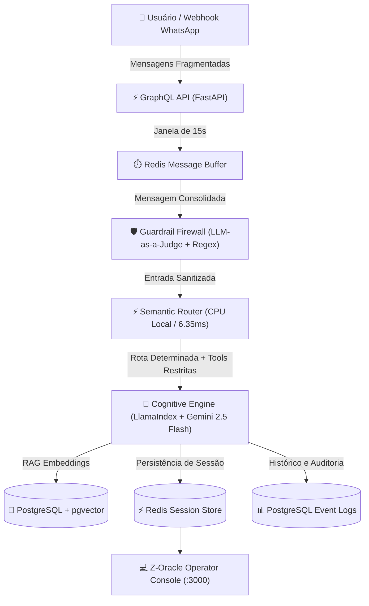

# Relatório Técnico: Arquitetura de Software — Z-Oracle Atendee

Este documento descreve a arquitetura de engenharia, os fluxos assíncronos e o conjunto de tecnologias que compõem o **Z-Oracle Atendee** — uma plataforma de atendimento conversacional inteligente, orientada a eventos e projetada para alta disponibilidade, segurança contra injeções de prompt e latência ultra-baixa em ambientes de missão crítica.

---

## 1. Visão Geral do Sistema

O **Z-Oracle Atendee** foi concebido para resolver o problema clássico de bots corporativos: **alucinação descontrolada, alto custo por token e fragilidade perante entradas caóticas de usuários**.

A solução adota uma abordagem híbrida que combina **computação local determinística (C-compiled / NumPy)** para triagem preliminar e **modelos generativos de última geração (Google Gemini)** orquestrados via **Tool Scoping** e **LlamaIndex** apenas quando há real necessidade de inferência cognitiva.

---

## 2. Componentes e Funcionalidades Core

### 2.1 Roteamento Inteligente e Determinístico (Zero-Cloud Latency)
* **O que faz:** Antes de acionar qualquer modelo de linguagem de grande porte (LLM), o sistema avalia a intenção da mensagem. Saudações triviais ou dados estruturados (como CPF) são resolvidos em menos de **7 ms** diretamente na CPU do container, economizando 100% dos tokens de inferência na nuvem.
* **Tecnologias:** `all-MiniLM-L6-v2` embarcado localmente, `NumPy` para cálculo de produto escalar acelerado por hardware e Regex compilado.

### 2.2 Motor Cognitivo e RAG Dinâmico com Segmentação Semântica
* **O que faz:** Responde a dúvidas operacionais e regulamentares consultando uma base vetorial atualizável em tempo real. Implementa *Semantic Chunking* por tags estruturais para evitar o fenômeno do "Cérebro Dividido" (quando contextos de diferentes produtos se misturam e geram alucinações).
* **Tecnologias:** `LlamaIndex` (VectorStore + Tool Scoping), Embeddings semânticos locais (384 dimensões), `pgvector` sobre PostgreSQL 16.

### 2.3 Prevenção Ativa de Ataques (Security Guardrails)
* **O que faz:** Funciona como um Web Application Firewall (WAF) semântico contra *Prompt Injection*, vazamento de prompt de sistema e engenharia social. Nenhuma entrada do usuário é despachada para o agente principal sem passar pela verificação prévia de segurança.
* **Tecnologias:** Padrão *LLM-as-a-Judge* ultra-rápido com timeout rígido de 3 segundos (`gemini-1.5-flash`), sanitizadores via expressões regulares e detecção heurística.

### 2.4 Buffer de Debounce Assíncrono com Redis (15 Segundos)
* **O que faz:** No atendimento via mensageria (como WhatsApp), usuários habitualmente fragmentam uma única linha de raciocínio em múltiplas mensagens curtas enviadas em rajada (ex: *"Oi"*, *"Tudo bem?"*, *"Meu saque não caiu"*, *"O CPF é 123..."*). Disparar um LLM para cada fração gera custos exponenciais, alucinações de contexto e respostas atropeladas. O Z-Oracle implementa um buffer de debounce distribuído no Redis:
  1. A cada nova mensagem do mesmo remetente dentro da janela de 15 segundos, o timer é resetado e a mensagem é concatenada à fila temporária.
  2. Decorridos 15 segundos de silêncio, a mensagem agregada e coerente é enviada para o pipeline cognitivo uma única vez.
* **Tecnologias:** Listas e chaves temporárias no Redis com expiração configurável, tasks assíncronas em `asyncio` no FastAPI.

### 2.5 Gestão Contínua de Sessão e Compressão de Conhecimento (Rolling Memory)
* **O que faz:** Preserva o histórico conversacional, nome e CPF do cliente durante toda a sessão (TTL de 24 horas no Redis). Quando o histórico atinge limiares de tokens que comprometeriam a janela do modelo ou aumentariam o custo, um sumarizador em segundo plano compacta os turnos anteriores em um resumo factual de alta densidade sem perder os dados essenciais.
* **Tecnologias:** Redis Connection Pooling, serialização Pydantic e rotinas de compactação em background.

### 2.6 Anonimização de Dados Sensíveis e Conformidade LGPD
* **O que faz:** Mascara e ofusca proativamente documentos, cartões de crédito e informações de identificação pessoal (PII) antes que qualquer informação transite para provedores externos de LLM ou seja persistida em logs públicos.
* **Tecnologias:** Expressões regulares com cobertura para padrões documentais brasileiros, algoritmo do validador matemático `validate-docbr`.

### 2.7 Desacoplamento Assíncrono de Webhooks
* **O que faz:** Garante tempo de resposta imediato (`< 200 ms`) para os provedores de webhook (ex: Meta/WhatsApp Cloud API), devolvendo o handshake HTTP de sucesso imediatamente e delegando a inferência e logging para background workers desacoplados, prevenindo re-tentativas duplicadas e loops de requisições.
* **Tecnologias:** `asyncio.create_task`, FastAPI BackgroundTasks.

---

## 3. Matriz Tecnológica

| Componente | Tecnologia | Papel no Sistema | Justificativa de Engenharia |
| :--- | :--- | :--- | :--- |
| **Framework Backend** | FastAPI + Strawberry GraphQL | Gateway de APIs e Webhooks | Alta performance assíncrona, contratos estritos de tipos |
| **Orquestração Cognitiva** | LlamaIndex (`AgentWorkflow`) | Raciocínio baseado em ferramentas | Previne execuções fora de escopo via Tool Scoping rígido |
| **LLM Primário** | Google Gemini 2.5 Flash | Resolução conversacional e síntese | Excelente equilíbrio entre raciocínio, velocidade e custo |
| **LLM Segurança / Resumo** | Google Gemini 1.5 Flash | LLM-as-a-Judge e compactação | Resposta em < 1s para triagem e sanitização |
| **Embeddings & Roteamento** | `sentence-transformers` (`all-MiniLM-L6-v2`) | Vetorização semântica e RAG | Execução 100% local em CPU (sem dependência externa) |
| **Memória & Debounce** | Redis 7 (Alpine) | Buffer de mensagens e sessão ativa | Latência sub-milissegundo para debounce distribuído |
| **Banco de Dados & Vetores** | PostgreSQL 16 + `pgvector` | Armazenamento relacional e RAG | Persistência confiável com busca vetorial nativa integrada |
| **Console de Operação** | Node.js / Express / Cyberpunk UI | Painel do operador e telemetria | Inspeção em tempo real de metadados, sentimento e rotas |
| **IDE de Banco de Dados** | LibreDB Studio Web | Administração de dados e vetores | Gestão visual de embeddings e bases de conhecimento |

