## **Arquitetura Sistêmica de um Oráculo de Solução de Problemas**

### *Integração de Inteligência Artificial Generativa, Modelos Mentais e Orquestração Multiagente*

> 🔮 **Visão Geral —** Este documento descreve a arquitetura completa de um oráculo computacional capaz de analisar, desconstruir e propor soluções técnicas definitivas. A construção transcende LLMs isolados, exigindo formalização rigorosa que desloca a intuição para matrizes lógicas e inferência dedutiva.

A construção de tal sistema requer o abandono do raciocínio analógico superficial em favor de uma profunda decomposição estrutural. O oráculo deve categorizar a incerteza do ambiente, selecionar a metodologia apropriada, dividir tarefas entre agentes especializados, mitigar alucinações através de debates cruzados e estruturar a comunicação final para máxima absorção humana. O sucesso absoluto depende da capacidade de aplicar **meta-raciocínio contínuo** — avaliando não apenas os dados, mas as premissas epistemológicas subjacentes ao próprio processo de inferência.

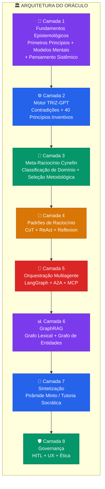

---

# 🧠 Camada 1 — Fundamentos Epistemológicos e Heurísticas

O núcleo cognitivo do oráculo deve ser programado com as ferramentas fundamentais do pensamento humano, traduzidas em algoritmos probabilísticos e instruções de sistema rigorosas. A dependência exclusiva da inferência estatística de um LLM resulta em **pensamento por analogia** — otimização de processos conhecidos, mas falha catastrófica diante de inovação disruptiva. Para gerar soluções originais, o sistema opera com **Primeiros Princípios**, **Pensamento Sistêmico** e um arcabouço de **modelos mentais avançados**.

## 🔬 A Desconstrução Através de Primeiros Princípios

> 🏛️ **Aristóteles →** O raciocínio a partir de Primeiros Princípios envolve a quebra de um problema complexo até suas proposições fundamentais — verdades básicas que não podem ser deduzidas de nenhuma outra suposição — permitindo a reconstrução de soluções a partir de uma fundação de rocha firme.

O mecanismo computacional baseia-se em rotinas inspiradas nos **Cinco Porquês** e no **questionamento socrático disciplinado**. Quando confrontado com ambiguidade técnica, o agente cognitivo:

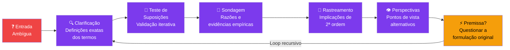

A implementação do raciocínio de primeiros princípios em modelos de linguagem evita confabulações baseadas em correlações estatísticas espúrias, forçando a validação de cada elo da cadeia causal antes de mapear o problema.

## 🌐 Integração de Modelos Mentais Multidisciplinares

A construção de uma **rede (latticework)** de modelos mentais capacita a IA a simplificar a complexidade em fragmentos gerenciáveis, capturando as grandes ideias de múltiplas ciências fundamentais.

| **Domínio** | **Modelo Mental** | **Aplicação no Oráculo** |
| --- | --- | --- |
| 🗺️ Epistemologia | **O Mapa Não É o Território** | Abstrações e dados vetoriais não substituem a complexidade mutável da realidade — exige atualizações contínuas |
| 🎯 Competência | **Círculo de Competência** | Reconhece limites dos dados de treinamento e invoca APIs externas quando a confiança cai abaixo do limiar |
| 🔄 Estratégia | **Inversão** | Mapeia e evita sistematicamente as condições que garantiriam o fracasso absoluto |
| ✂️ Lógica | **Navalha de Occam** | Prefere a explicação analítica mais simples e direta |
| 🤝 Viés | **Navalha de Hanlon** | Evita supor malícia onde incompetência sistêmica ou erro humano são causas prováveis |
| 📊 Probabilidade | **Atualização Bayesiana** | Calcula cenários em matizes de probabilidade, atualizando conforme novos dados chegam |
| 💰 Economia | **Custo de Oportunidade** | Cada alocação de recursos representa um sacrifício em outra frente operacional |

## 🔗 Pensamento Sistêmico e Dinâmica de Sistemas

> 🔗 Problemas crônicos raramente existem no vácuo — são sintomas de **sistemas subjacentes desalinhados**. O Pensamento Sistêmico visualiza o ambiente como uma vasta rede de componentes interdependentes.

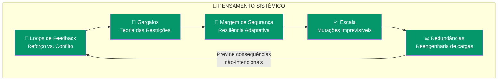

O oráculo concentra-se nas **estruturas e interações** que moldam o comportamento macroscópico ao longo do tempo. Acelerar qualquer componente que não seja o elo mais fraco é desperdício de energia. Processos lineares sofrem mutações imprevisíveis ao ganhar escala — exigindo reengenharia para evitar colapsos sob estresse.

---

# ⚙️ Camada 2 — TRIZ na Era GenAI

> ⚙️ **TRIZ (Teoria da Solução Inventiva de Problemas)** — Um kit de ferramentas algorítmicas concebido para suprimir o compromisso e o *trade-off* na engenharia. Desenvolvido por Genrich Altshuller (1946+) a partir da análise de milhares de patentes globais: **a criatividade técnica não é aleatória, mas estruturada em padrões repetitivos de evolução universal.**

O método opera identificando **contradições** — cenários onde a melhoria de uma funcionalidade degrada outra. A matriz tradicional cruza **39 × 39 características**, revelando os **40 Princípios Inventivos** para transcender o dilema.

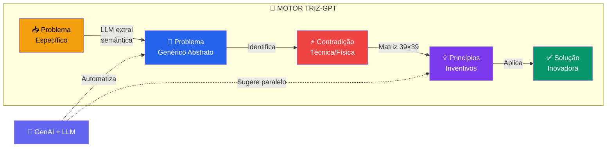

### Exemplos de Princípios Inventivos aplicados pelo Oráculo

| **Princípio TRIZ** | **Descrição** | **Exemplo de Aplicação** |
| --- | --- | --- |
| **P14 — Esferoidicidade** | Substituir formas retilíneas por curvas | Dissipação térmica + rigidez espacial → cúpulas espirais, forças centrífugas |
| **P15 — Dinâmica** | Dividir objeto em partes com movimento relativo | Rigidez material em ambientes dinâmicos → transformar inflexível em adaptativo |
| **P13 — Ação Invertida** | Inverter a abordagem convencional | Estrangulamento de fluxo → esfriar núcleo ao invés de aquecer exterior |

A fusão TRIZ + GenAI **democratiza o acesso à inovação**, automatizando extração semântica, enquadramento de contradições e sugestão paralela de princípios — resolvendo contradições até em nível atômico.

---

# 🧭 Camada 3 — Meta-Raciocínio e Framework Cynefin

> 🧭 **Cynefin** (Dave Snowden) — Um dispositivo de *sense-making* que determina **"como pensar" antes de decidir "o que pensar"**. O oráculo utiliza meta-raciocínio para classificar consultas nos domínios do Cynefin, evitando a **dissonância de domínio** — atuar em ambiente complexo com ferramentas de sistemas simples.

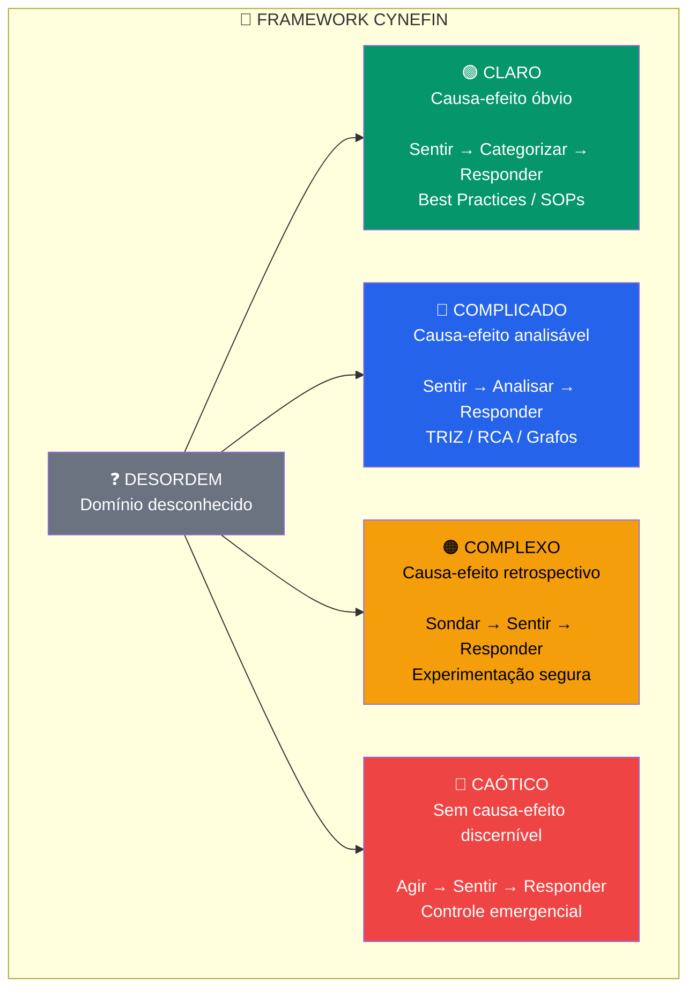

### 🔀 A Arquitetura Híbrida Cynefin-TRIZ para Solução Multiconflito

A fusão do Cynefin com o TRIZ reestrutura o framework a partir de uma **"perspectiva de conflito"**:

- **Domínios Claro/Complicado →** Extrai contradições via modelo **Elemento-Nome-Valor (ENV)**
- **Domínios Caótico/Complexo →** Algoritmos de pesquisa de efeito forçam redução da dimensionalidade caótica até domínios gerenciáveis

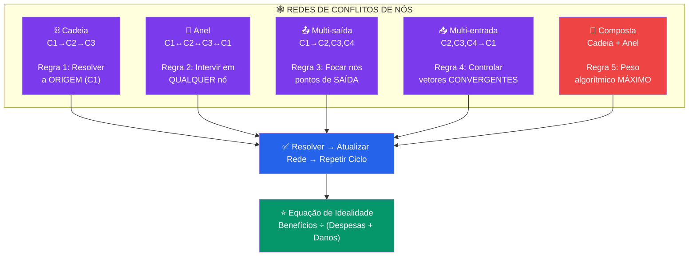

---

# 🤖 Camada 4 — Padrões de Raciocínio de IA

Agentes puramente baseados em prompts isolados são limitados pela memória episódica restrita e propensão ao colapso lógico. O oráculo adota padrões avançados que mimetizam e amplificam processos investigativos complexos.

## ⚡ Cadeia de Pensamento (CoT), ReAct e Reflexion

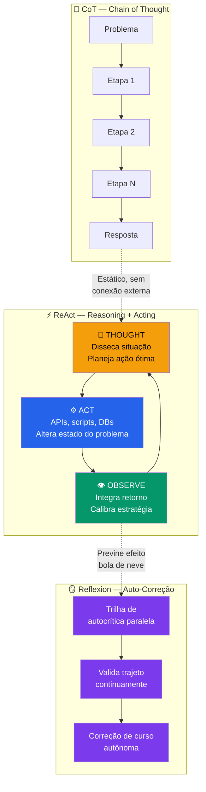

> ⚠️ **Efeito Bola de Neve** — Um compromisso precoce com hipótese ligeiramente incorreta amplifica o desvio a cada nova etapa. O padrão **Reflexion** mantém trilhas de autocrítica em paralelo, permitindo correções de curso autônomas antes do relatório final.

---

# 👥 Camada 5 — Orquestração Multiagente (MAS)

A dependência de um único agente generalista é fadada ao gargalo. O design robusto subdivide tarefas em entidades especializadas dentro de um **Sistema Multiagente (MAS)**.

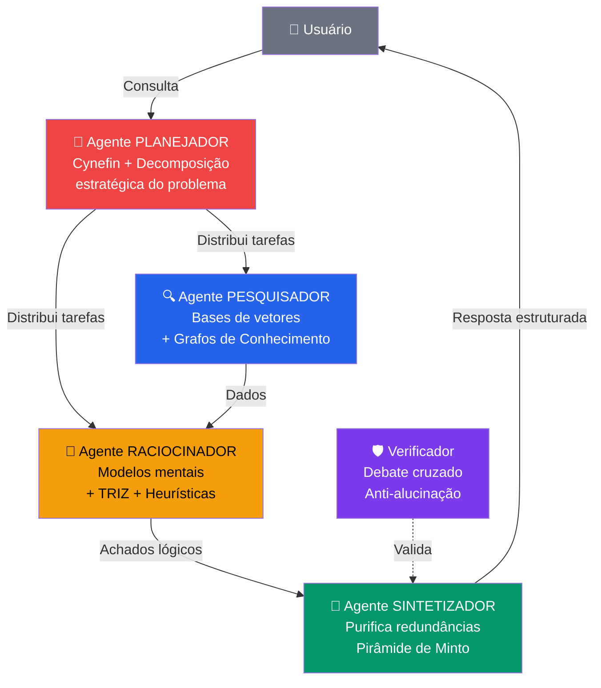

## 🏆 Comparação de Frameworks: LangGraph vs CrewAI vs AutoGen

| **Critério** | **🟢 LangGraph** | **🔵 CrewAI** | **🟡 AutoGen** |
| --- | --- | --- | --- |
| **Paradigma** | Grafos de Estado + DAGs determinísticos | Delegação em equipes por papéis | Mensagens assíncronas conversacionais |
| **Estado/Memória** | Checkpoints precisos + rollback seguro | Contexto compartilhado hierárquico | Histórico de chat acumulado |
| **Erros** | Nós de grafo com roteamentos compensatórios | Redistribuição pela crew | Reparo verbal coletivo |
| **Uso Ideal** | **Escala empresarial + HITL** | Prototipagem rápida + automação leve | Acadêmico + simulações |

> ✅ **Decisão →** O oráculo ancora-se em grafos de estado estruturados combinados com LlamaIndex, onde cada subetapa é um nó controlável que assegura integridade ao processo decisório. Interoperabilidade via protocolos **A2A** (Agent-to-Agent) e **MCP** (Model Context Protocol).

---

# 📊 Camada 6 — GraphRAG: Conhecimento Estruturado em Múltiplos Saltos

> 🚫 **Limitação do RAG puro →** Similaridade vetorial isola textos em fragmentos e prioriza por "vizinhança espacial de tokens". Perde contextura periférica essencial e fracassa na agregação global para raciocínio em **múltiplos saltos** (*Multi-Hop Reasoning*).

O **GraphRAG** combina o poder probabilístico dos LLMs com o determinismo rígido dos **Grafos de Conhecimento**:

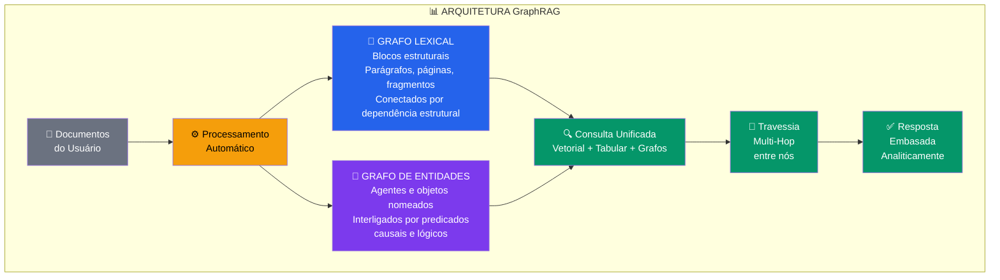

Capacidades resultantes:
- **Contagem relacional** das entidades
- **Rastreamento ontológico** abrangente
- **Mitigação** de resultados repetitivos (K-NN limitado)
- **Navegação topológica** segura sobre dados privados

---

# 📝 Camada 7 — Sintetização de Respostas e Experiência Cognitiva

## 🔺 O Princípio da Pirâmide de Minto

O oráculo adota **BLUF** (*Bottom Line Up Front*) — a resolução técnica conclusiva vem primeiro.

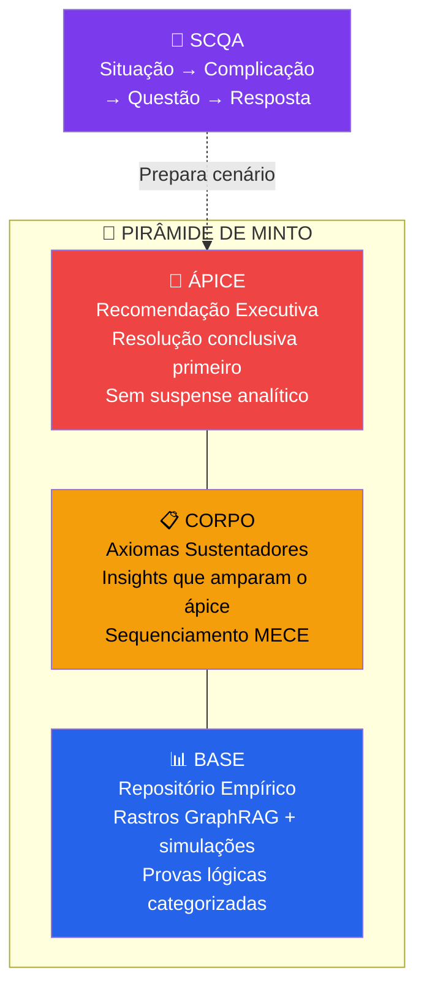

> 📐 **MECE** (*Mutuamente Exclusivo, Coletivamente Exaustivo*) — Sem sobreposição semântica entre opções (exclusividade limpa) e cobertura de 100% das possibilidades (exaustão sistêmica).

## 🏛️ Tutoria Socrática Contra a Descarga Cognitiva

Em ambientes de ensino ou design investigativo conjunto, o oráculo transmuta da pirâmide vertical para um modelo interativo centrado na **progressão epistêmica**.

> ⚠️ **Descarga Cognitiva** — Profissionais internalizam a facilidade passiva da resposta e cedem capacidade orgânica de resolução dedutiva à máquina, sufocando habilidades críticas inerentes.

A mitigação invoca **Sistemas Inteligentes de Tutoria (ITS)**:
- 🔍 Indagações sondadoras via questionamento socrático — testa vieses implícitos do interlocutor
- 🧠 Modulação de **carga cognitiva mínima** da memória de trabalho humana
- 🧪 **Falhas produtivas** em ambientes fechados de testes — segurança total para internalização paulatina

---

# 🛡️ Camada 8 — Governança Ética, Anti-Alucinação e HITL

> 🛡️ **Ameaças →** Caixa-preta heurística, falhas silenciosas, alucinações cognitivas, viés de automação e exclusões discriminatórias camufladas. A fronteira ética impõe protocolos de neutralização via **debates cruzados multiagente**.

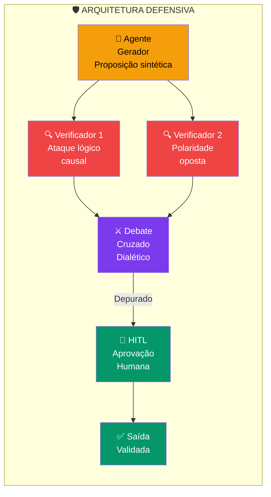

## 👤 Human-in-the-Loop (HITL)

| **Padrão HITL** | **Mecanismo** | **Propósito** |
| --- | --- | --- |
| **🔒 Checker Pattern** | Chamadas externas e engajamentos modificadores nunca possuem permissões ativas até aprovação humana expressa | Imuniza contra falhas de restrições de prompt volúveis |
| **🏗️ Architect in the Loop (AITL)** | Especialistas injetam avaliações sistêmicas no design: robustez contra adversários, segurança de aprendizado ativo, imunização de pipelines | Transfere políticas de reação isolada para design cibernético intrínseco |

## 🎨 Padrões de UX Design para Confiança Cognitiva

| **Padrão UX** | **Fundamentação** | **Impacto** |
| --- | --- | --- |
| **👁️ Clear AI Decision Display** | Demonstra rastros base extraídos dos vetores e lógicas utilizadas | Dissolve assombro das caixas-pretas; alavanca legitimação e transparência |
| **🔄 Smart Error Handling** | Fallbacks arquitetônicos visíveis com rollbacks controlados | Erradica frustrações catastróficas e abandono tecnológico |
| **📊 Smart Visual Pattern** | Respostas convertidas em representações gráficas dinâmicas | Compactação informacional para decisões estratégicas velozes |

---

## 🏁 Síntese Final

> 🔮 Esta engrenagem sistêmica transfigura explorações estocásticas experimentais em um **cérebro analítico cibernético de robustez perene**:
> - 🧠 **Epistemologia Aristotélica** + heurísticas orgânicas multifacetadas
> - ⚙️ **Convergência mecânica do TRIZ** para engenharia inventiva
> - 🧭 **Reinos complexos do Cynefin** para meta-raciocínio dinâmico
> - 👥 **Orquestração multiagente** com mitigação de deslizes
> - 📊 **Bancos vetoriais relacional-gráficos** contra deficiências crônicas
> - 🛡️ **Blindagem ética e perceptiva** contra contaminações morais
