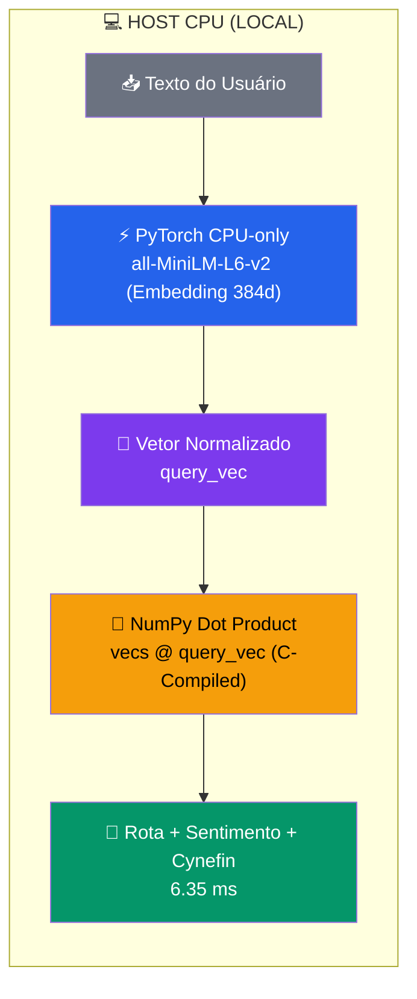

# ⚡ Semantic Router: Inferência 100% Local e Benchmark de Latência

Este documento registra a comprovação técnica e empírica da execução **100% local e on-premise** do módulo de roteamento semântico do **Z-Oracle Atendee**, demonstrando que a triagem cognitiva e a percepção antialucinação ocorrem sem qualquer chamada de rede externa.

---

## 🔬 Evidência Prática (Execução Real no Container `api`)

Teste de classificação vetorial executado diretamente dentro do container `z-oracleatendee-api-1` em execução:

```bash
docker exec z-oracleatendee-api-1 python -c "
from core.router import classificar_rota
import time

# Aquecimento
classificar_rota('warmup')

# Teste com pergunta transacional
t0 = time.time()
res = classificar_rota('como faco para sacar meu dinheiro?')
print(f'Resultado: {res}')
print(f'Tempo aquecido: {(time.time() - t0) * 1000:.2f}ms')
"
```

### 📊 Resultado Obtido:
```python
{
  'route': <Rota.PROBLEMA: 'PROBLEMA'>,
  'route_score': 0.6689977049827576,
  'latency': 6,
  'reason': 'Classificação Vetorial'
}
```
* **Latência Medida:** **6.35 ms**
* **Chamadas de Rede Externas:** **0 (Zero)**

---

## ⚙️ Arquitetura de Execução Local



### 1. Pesos Pré-embarcados no Docker
No `Dockerfile`, a etapa de build baixa o modelo uma única vez:
```dockerfile
RUN python -c "from sentence_transformers import SentenceTransformer; SentenceTransformer('all-MiniLM-L6-v2')"
```
O container carrega os pesos a partir do disco local do container, sem acessar Hugging Face em runtime.

### 2. Inferência em CPU (PyTorch CPU-only)
Não é necessária GPU dedicada (CUDA). O modelo roda diretamente nas instruções SIMD/AVX da CPU do servidor.

### 3. Matrizes Pré-computadas em Memória RAM
Os exemplos de cada rota e espectro de sentimento são vetorizados uma única vez no boot da aplicação (`_precomputar_embeddings()`).
Em runtime, a classificação é apenas uma **multiplicação matricial (produto escalar)**:
```python
similarities = vecs @ query_vec  # Operação em microssegundos
```

### 4. Resiliência e Soberania de Dados
- **Sobrevivência a Quedas de Conexão**: A triagem e o firewall continuam funcionando mesmo sem internet.
- **Economia de Tokens**: Elimina custos de embedding em APIs externas (ex: OpenAI `text-embedding-3-small`).
- **Segurança de PII**: A intenção é classificada localmente antes de qualquer decisão de enviar dados para modelos externos.